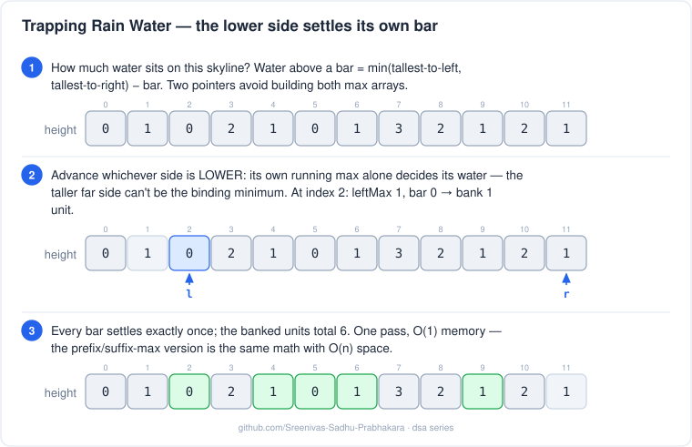

# Trapping Rain Water

> Striver SDE Sheet 040 · Day 7 LL & Arrays — two pointers from the ends; the lower side's running max alone bounds the water there. Go, stdlib only, tested.

## Problem

Given bar heights, compute how much rain water the profile holds. Water above a bar is `min(highest to its left, highest to its right) − its height` — the question is computing that without materializing both max arrays.

## Approach

Work inwards from both ends, always advancing the side with the lower bar. The insight that collapses the space to O(1): when `height[l] ≤ height[r]`, the left bar's water is settled by `leftMax` alone — some bar on the right (at least `height[r]`) is already as tall or taller, so the right side can't be the binding minimum. Each step either raises that side's running max or banks water, and every bar is settled exactly once. The prefix/suffix-max arrays version is the same mathematics with O(n) memory; this is the refined form.

**Complexity:** O(n) time, O(1) space.

## Visual walkthrough

Read the picture top to bottom — each numbered frame is one moment of the algorithm
running on this repo's test example.

## Run

    go test ./...   # verify
    go run .        # demo

---

One of 191 repos solving Striver's SDE Sheet in Go — stdlib only, one problem per repo, every solution tested. Browse the set: [`dsa-*` repos](https://github.com/Sreenivas-Sadhu-Prabhakara?tab=repositories&q=dsa-&type=source).
